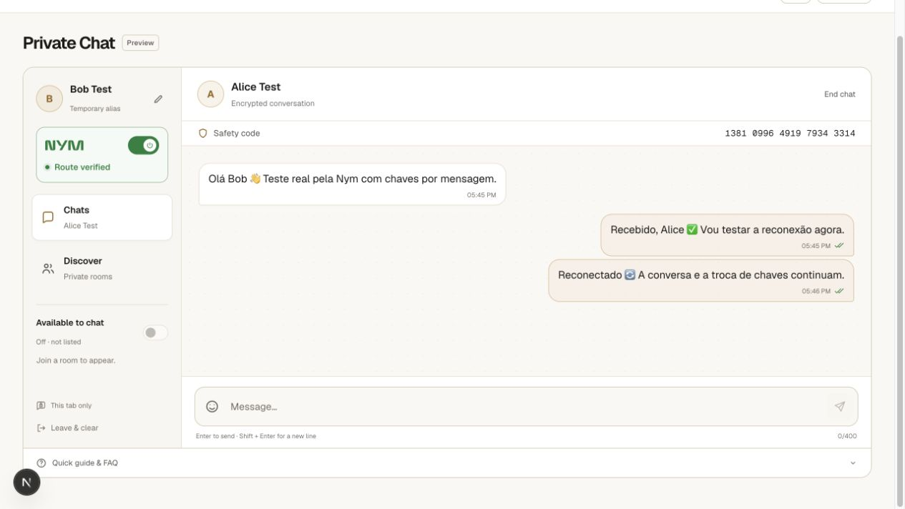

# Private Chat — ratchet e validação antes da publicação

Data: 15/10/2026. Branch `michae2xl/private-chat`. Alterações locais; sem merge ou publicação.

## Implementação

O protocolo v3 exige Olm Double Ratchet para mensagens, confirmações, reconexão e encerramento. Usa `@matrix-org/matrix-sdk-crypto-wasm@18.9.0`, implementação oficial mantida, com estado somente em memória. Não há servidor Matrix nem upload de chaves para terceiros. O convite e o envelope autenticado existente vinculam as identidades; cada evento ratchet também inclui conversa, remetente e destinatário.

Contas novas são criadas por conversa. Reconectar mantém a conta e a sequência de chaves; encerrar/recusar/expirar libera o estado. Retransmissões recebem um novo ciphertext; o ID lógico impede duplicar a mensagem. Pacotes v2 e dados de conversa protegidos apenas pela chave estática são recusados. Há limites de tamanho, fila e chaves de mensagens fora de ordem.

A integração também corrige aceite concorrente com recusa. A validação servida identificou e corrigiu a conferência da origem pública atrás do proxy e o início indevido de tarefas do portal no processo isolado do chat. Ver [ADR](../private-chat-crypto-decision.md) e [runbook](../private-chat-pilot-runbook.md).

## Verificações locais

- Vitest completo: **3.874 passaram, 12 ignorados**, 292 arquivos passaram e 3 ignorados. Concorrência limitada a dois workers, timeout de teste 30s nesta execução; configuração global preservada.
- Complementos Node: **56/56 passaram**.
- Regressão do chat: **114/114** em 19 arquivos; inclui 9 testes com WASM real do ratchet e 27 do controlador.
- TypeScript completo e ESLint dos arquivos alterados passaram.
- `npm audit --omit=dev`: **zero alertas**; isso não equivale a uma auditoria criptográfica.
- Revisão interna adicional não encontrou novos achados acionáveis. Não substitui revisão externa independente.

## Navegador e mixnet real

Duas abas independentes no navegador integrado, na mesma máquina/rede, carregando o preview atual em `127.0.0.1:4430`:

1. Duas identidades temporárias e duas rotas Nym com roundtrip verificado.
2. Convite, solicitação e aceite explícito; código de segurança igual nas duas telas.
3. Mensagens em ambos os sentidos com emoji e confirmação de entrega.
4. Desligamento da Nym desabilita a mensagem; ligar novamente restaura a conversa.
5. Nova mensagem após reconexão recebida e confirmada.
6. Encerramento recebido pelo contato; Leave limpa as duas sessões.

O WASM da nova biblioteca carregou no navegador sem erro de console observado. Captura feita antes da limpeza:

A evidência acima não representa dois dispositivos físicos ou redes de acesso distintas. O preview usa o diretório de desenvolvimento; a validação do serviço nativo/SURB é registrada separadamente abaixo.

## Build servido

**Build final concluído com exit 0**: compilação, TypeScript e geração de 36 páginas. Turbopack com concorrência limitada resolveu o build anterior interrompido. **68/68 verificações HTTP passaram** na versão servida: nonce nos 35 scripts, CSP, no-store/no-referrer, WASM com hash e MIME corretos, origem e rotas indevidas bloqueadas. O processo isolado não inicia os schedulers do portal.

O servidor local de produção usou configuração pública sintética para cabeçalhos/isolamento; não equivale a um domínio HTTPS público configurado. Foi encerrado após a validação. O preview de desenvolvimento permanece em 4430. [Relatório de build](private-chat-build-2026-10-15.md) e [verificações servidas](private-chat-build-2026-10-15/served-checks.json).

## Serviço nativo e SURB

**Nove fluxos passaram em aproximadamente 55 segundos, exit 0**, com o controlador final e duas instâncias reais do worker Nym. Diretório em ambiente Linux de testes separado, binário oficial `nym-binaries-v2026.20-glasgow` com SHA-256 verificado, runtime exato compilado, armazenamento cifrado, lock de kernel e portas somente em loopback. `requireSURB=true`: sem fallback para respostas por endereço.

Foram confirmados Discover cifrado, pedido/aceite, dez mensagens alternadas, falha fechada ao ficar offline, reconexão com outras duas mensagens, encerramento, recusa e rejeição local de convite vencido. **12 mensagens com recibos**, 47 pacotes submetidos e recebidos, seis operações anônimas de diretório, três conexões dos clientes. Quinze chamadas autorizadas de topologia e zero destinos HTTP inesperados no worker observado. Os hashes dos arquivos sob teste foram conferidos ao terminar.

A execução usou dois clientes independentes na mesma máquina/rede, com o serviço nativo remoto. Não representa dois aparelhos de usuário, ensaio de carga, volume durável de produção ou restart real do cliente nativo. O launcher temporário usou `flock` Linux com descritor herdado, mantendo a validação do runtime; o launcher Python de produção tem testes locais próprios.

O serviço registrou seis pedidos recebidos e seis respostas enfileiradas, sem descarte ou falha. Limpeza confirmada: zero processos de teste, zero listeners nas portas 1977/1978, diretório temporário e identidades removidos. Nenhuma configuração, restart, endpoint público ou implantação foi alterado no serviço existente. [Relatório sanitizado com hashes](private-chat-ratchet-2026-10-15/real-nym-native-surb.json) e [notas operacionais](private-chat-ratchet-2026-10-15/real-nym-notes.md).

## Limites de lançamento

Não houve publicação. Permanecem necessários domínio HTTPS exclusivo e configuração operacional real, revisão de logs/volumes/segredos, teste em aparelhos/redes e navegadores móveis, ensaio sustentado das duas salas e revisão criptográfica independente da integração.

Olm evolui chaves por mensagem. Os testes não simulam extração completa do estado secreto do WASM nem certificam recuperação após comprometimento. A página aberta mantém mensagens legíveis; comprometimento do dispositivo ou JavaScript pode expô-las. Host HTTPS, API de topologia e gateway de entrada ainda podem observar o IP de conexão. Não anunciar privacidade máxima ou equivalência ao Signal.
